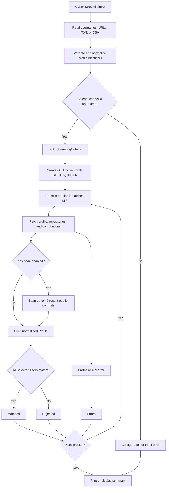
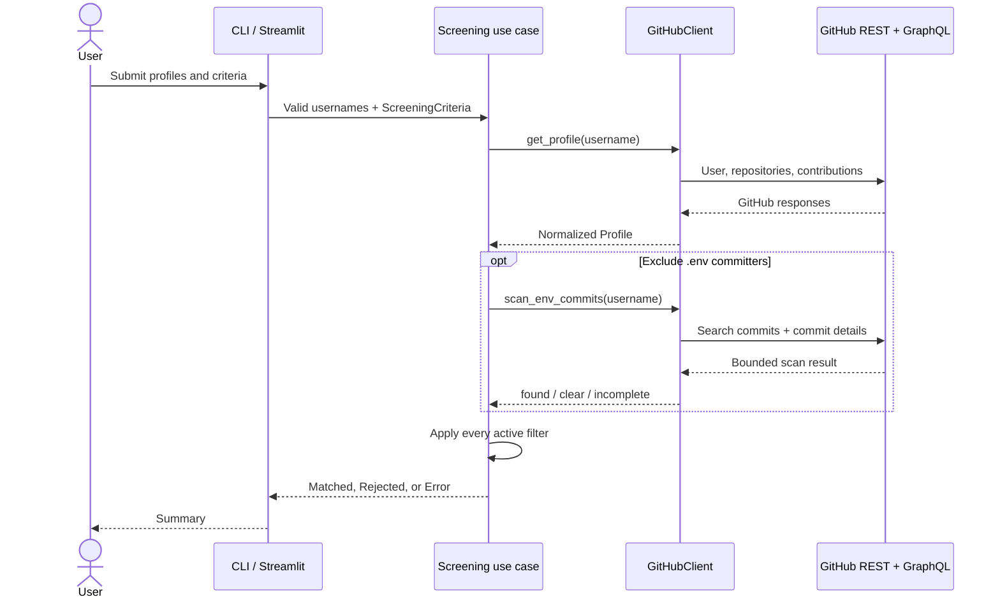
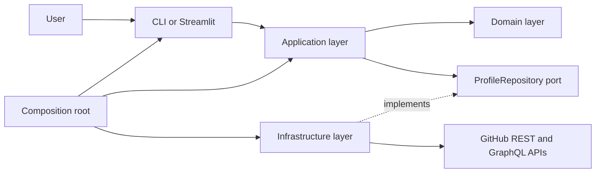
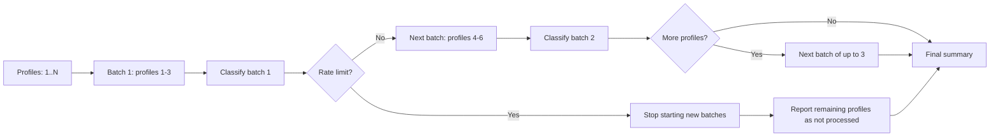

# GitHub Profile Screener

`gh-screener` screens GitHub profiles against configurable criteria and
classifies them as **Matched**, **Rejected**, or **Errors**.

The project provides:

- a command-line interface (CLI);
- an optional Streamlit interface;
- one shared screening workflow and GitHub client for both interfaces;
- Docker images for the CLI and Streamlit, with Ollama available through
  Docker Compose.

It does **not** provide a REST or JSON API. The CLI and Streamlit interface are
separate entry points; Streamlit and Ollama can be run together with Docker
Compose.

## Contents

- [How it works](#how-it-works)
- [Architecture](#architecture)
- [Important design choices](#important-design-choices)
- [Requirements](#requirements)
- [Installation and configuration](#installation-and-configuration)
- [CLI quick start](#cli-quick-start)
- [CLI reference](#cli-reference)
- [Input files](#input-files)
- [Screening criteria](#screening-criteria)
- [Streamlit interface](#streamlit-interface)
- [Docker](#docker)
- [Development and tests](#development-and-tests)
- [Project structure](#project-structure)
- [Troubleshooting](#troubleshooting)
- [License](#license)

## How it works

1. Profile names and URLs are read from the command line or an input file.
2. The inputs are validated and converted to GitHub usernames.
3. The application fetches profile, repository, and contribution data from
   GitHub.
4. Every selected criterion is applied to each profile.
5. Results are printed in three groups: `Matched`, `Rejected`, and `Errors`.

Profiles are processed in batches of up to three concurrent requests. The
original input order is preserved within the results. A profile error does not
stop the other profiles from being processed. If GitHub rate-limits a batch,
that batch finishes and later profiles are reported as not processed.

All selected criteria must match. With no criteria selected, every profile
that can be fetched successfully is matched.

### End-to-end flow



### One profile and one batch



## Architecture

The application is split into layers so that screening rules do not depend on
the GitHub HTTP implementation:



- **CLI**: parses arguments, reads files, validates profile identifiers, and
  renders text output.
- **Streamlit**: provides a graphical input and result view, while reusing the
  same application and domain layers.
- **Application**: coordinates batches, concurrency, error handling, and
  result classification.
- **Domain**: contains the profile model, criteria, and pure filter rules.
- **Infrastructure**: calls GitHub, retries temporary failures, maps responses
  to domain objects, and translates HTTP errors.
- **Composition root**: creates the concrete GitHub client and injects it
  through the `ProfileRepository` port.

This dependency direction makes the domain and application layers testable
without contacting GitHub. Unit tests use repository fakes; integration tests
are explicitly marked because they call the live API.

## Important design choices

### Why three profiles at a time?

The application uses a `ThreadPoolExecutor` with a maximum of three workers.
Each worker can fetch one profile while the other workers are waiting for
GitHub network responses. This reduces the total waiting time compared with
strictly sequential processing, without creating an unbounded number of
requests.

Profiles are submitted in explicit batches of three rather than as one large
unbounded queue. This gives the application a controlled request footprint and
creates a clear stopping point when GitHub reports a rate limit:



The current batch is allowed to finish because its workers may already have
started requests when the rate limit is observed. Profiles in later batches
are not started and are reported in `Errors` with a clear message instead of
being silently dropped.

### Why preserve input order?

`executor.map` returns outcomes in the same order as the submitted usernames,
even though the network requests finish at different times. This makes the
output deterministic and easier to compare with the input file. Results are
still separated into `Matched`, `Rejected`, and `Errors`, but the order within
each category follows processing order.

### Why distinguish Rejected from Errors?

- **Rejected** means GitHub data was fetched successfully and at least one
  selected criterion did not match.
- **Errors** means the profile could not be evaluated reliably: invalid input,
  an unknown user, authentication failure, rate limit, network/API failure, or
  an incomplete `.env` scan.

This distinction prevents unavailable or uncertain data from being presented
as a negative screening decision.

### Why require every selected criterion?

Filters are composed with AND semantics. A profile is `Matched` only when it
passes every active rule. This avoids returning a profile that satisfies one
requirement while missing another explicit requirement. Multiple
`--languages` options follow the same rule: every requested language must be
present.

### Why scan only a bounded number of commits?

The `.env` check is an additional GitHub Search and commit-detail workflow.
Limiting it to 40 commit details controls latency and API usage. Because a
bounded scan cannot prove that no matching commit exists outside the sample,
an incomplete scan produces an `Error`, not a false `Matched` result.

## Requirements

- Python 3.11 or newer;
- a GitHub personal access token in `GITHUB_TOKEN`;
- Docker Desktop or another Docker Engine with the Compose plugin, only for
  Docker usage;
- Streamlit 1.40 or newer, only for the optional web interface;
- Ollama and the `qwen2.5:3b` model, only for the Streamlit AI mode.

The application requests public GitHub data, but it still requires a token for
authenticated API access. Keep the token out of source code, commits, Docker
images, and command history where possible.

## Installation and configuration

From the repository root, create a virtual environment and install the
package:

### Windows PowerShell

```powershell
python -m venv .venv
.venv\Scripts\Activate.ps1
python -m pip install -e ".[dev]"
Copy-Item .env.example .env
```

### Linux or macOS

```bash
python -m venv .venv
source .venv/bin/activate
python -m pip install -e ".[dev]"
cp .env.example .env
```

Set the token in `.env`:

```dotenv
GITHUB_TOKEN=your_github_personal_access_token
```

The process environment takes precedence over `.env`. The project `.env` is
loaded from the repository root, beside `pyproject.toml`.

## CLI quick start

Show help:

```console
gh-screener --help
```

Screen one or more usernames:

```console
gh-screener octocat AyaMrm --commits active
```

Profile URLs are accepted too:

```console
gh-screener https://github.com/octocat --languages Python --languages Go
```

Read profiles from a file:

```console
gh-screener --file candidates.csv --public-repositories senior-dev
```

The installed command is equivalent to:

```console
python -m gh_screener.main octocat --commits active
```

## CLI reference

Profile inputs can be positional arguments, file entries, or both. Positional
arguments are processed first, followed by entries from `--file`.

| Option | Description |
| --- | --- |
| `USERNAME_OR_URL...` | One or more GitHub usernames or profile URLs. |
| `--file`, `-f PATH` | Read profile identifiers from a `.txt` or `.csv` file. |
| `--commit-contributions`, `--commits LEVEL` | Filter recognized GitHub commit contributions from the last 365 days. |
| `--languages LANG` | Require a programming language. Repeat the option for multiple languages. |
| `--public-repositories LEVEL` | Filter by the number of public repositories. |
| `--exclude-env-committers` | Reject profiles with a detected committed `.env` file. |
| `--help` | Display command help. |

Example:

```console
gh-screener octocat AyaMrm `
  --commits active `
  --public-repositories senior-dev `
  --languages Python
```

On Linux or macOS, use `\` instead of PowerShell's backtick for a multiline
command, or write the command on one line.

### Exit codes

| Code | Meaning |
| --- | --- |
| `0` | Screening completed; matches and rejections are normal results. |
| `1` | Screening could not start: missing input, invalid file, unknown criterion, or missing token. |
| `2` | Screening ran, but at least one input or profile produced an error. |

## Input files

Input files must be UTF-8. A UTF-8 BOM is accepted. Supported extensions are
`.txt` and `.csv`; Excel `.xlsx` files are not supported.

### Text files

Text files may contain several identifiers per line, separated by spaces or
tabs. Empty lines and lines beginning with `#` are ignored.

```text
# candidates.txt
octocat AyaMrm
https://github.com/torvalds
```

### CSV files

CSV files must contain a `username` column. The column name is
case-insensitive, and comma or semicolon delimiters are supported. Other
columns are ignored.

```csv
username,note
octocat,example profile
AyaMrm,second profile
```

## Screening criteria

### Commit contributions

`--commits` is an alias for `--commit-contributions`. Values are based on
GitHub's `totalCommitContributions` over the rolling 365-day period:

| Level | Requirement |
| --- | --- |
| `low` | 0 to 49 contributions |
| `active` | At least 50 |
| `highly-active` | At least 200 |
| `very-active` | At least 500 |
| `legendary` | At least 2,000 |

### Public repositories

| Level | Requirement |
| --- | --- |
| `senior-dev` | At least 20 public repositories |
| `github-ceo` | At least 50 public repositories |

Public repositories include forks. Private repositories are excluded.

### Languages

Use the language name as it appears in GitHub, for example `Python`, `Go`, or
`TypeScript`. Matching is case-insensitive. A profile must contain **every**
language passed with repeated `--languages` options among its public,
non-fork repositories. Repositories without a detected primary language are
ignored for this criterion.

### `.env` commit scan

`--exclude-env-committers` searches recent public commits attributed to the
user and inspects commit file names. It does not download file contents.

The scan ignores common templates such as `.env.example`, `.env.sample`,
`.env.template`, `.env.defaults`, and `.env.dist`. A detected `.env` file
rejects the profile.

The scan is deliberately bounded to 40 commit details. If GitHub returns an
incomplete or inconsistent sample, the profile is placed in `Errors` rather
than being treated as clear. This check is not proof that a user has never
committed a secret file.

## GitHub API behavior

The client uses:

- `GET /users/{username}` for profile data;
- paginated `GET /users/{username}/repos` for repositories;
- `POST /graphql` for contributions over the last 365 days;
- `GET /search/commits` and commit detail endpoints for the optional `.env`
  scan.

Requests have a 10-second timeout. Network errors and temporary HTTP
responses (`408`, `500`, `502`, `503`, `504`) are retried up to three times.
Authentication failures, missing users, and rate-limit responses are not
retried.

Profile data is fetched on every run; it is not persisted between runs.

## Streamlit interface

From the repository root, install the optional web dependency:

```console
python -m pip install -e ".[web]"
```

Run it from the `interface` directory so its theme configuration is loaded:

### Windows PowerShell

```powershell
Set-Location interface
streamlit run streamlit_app.py
```

### Linux or macOS

```bash
cd interface
streamlit run streamlit_app.py
```

The interface supports:

- adding usernames or GitHub profile URLs;
- uploading `.txt` or `.csv` files;
- selecting commit, language, repository, and `.env` criteria;
- viewing matched, rejected, and errored profiles.

Its **AI** mode sends the natural-language request to a local Ollama server
using the `qwen2.5:3b` model. Install Ollama, start its local server, and
download the model before using that mode:

```console
ollama pull qwen2.5:3b
```

Ollama must remain available while parsing requests. The application validates
the model's JSON response and applies deterministic mappings for supported
categories such as `active`, `highly-active`, `senior-dev`, and `github-ceo`.
It shows the interpreted criteria before screening; review them because
natural-language interpretation can still be imperfect. If Ollama is
unavailable or the response is invalid, the interface reports a parsing error
instead of screening with those criteria.

The uploader splits text on whitespace, commas, and semicolons; unlike the
CLI, it does not apply the CSV `username`-column parser.

## Docker

The Dockerfile has separate `cli` and `streamlit` build targets. Both run as a
non-root user. The Streamlit image includes the optional web dependency, while
Docker Compose runs it alongside the official Ollama image and downloads the
`qwen2.5:3b` model into a persistent volume on first startup.

Create `.env` from `.env.example` at the repository root and set `GITHUB_TOKEN`
before starting the services. From the repository root, run:

```console
docker compose up --build -d
```

Open <http://localhost:8501>. The first startup needs to download the Ollama
model and may take several minutes. Follow the service logs with:

```console
docker compose logs -f streamlit ollama-model
```

Stop the services with `docker compose down`. The downloaded model stays in the
`ollama_data` volume. Use `docker compose down -v` only when you also want to
delete that model cache.

To build and run the CLI image instead:

```console
docker build --target cli -t gh-screener:cli .
docker run --rm --env-file .env gh-screener:cli octocat --commits active
```

Do not copy the token into either image. To use a local input file with the
CLI, mount it read-only:

### Windows PowerShell

```powershell
docker run --rm --env-file .env `
  --mount "type=bind,source=$((Resolve-Path .\profiles.txt).Path),target=/app/profiles.txt,readonly" `
  gh-screener:cli --file /app/profiles.txt --commits active
```

### Linux or macOS

```bash
docker run --rm --env-file .env \
  --mount "type=bind,source=$PWD/profiles.txt,target=/app/profiles.txt,readonly" \
  gh-screener:cli --file /app/profiles.txt --commits active
```

## Development and tests

Install development dependencies with:

```console
python -m pip install -e ".[dev]"
```

Run linting and tests:

```console
ruff check .
pytest
```

Run only offline tests:

```console
pytest -m "not integration"
```

Run live GitHub integration tests:

```console
pytest -m integration
```

Integration tests require `GITHUB_TOKEN`, contact GitHub, and can be affected
by network availability or API rate limits. Continuous integration currently
runs Ruff and Pytest on Python 3.12.

## Project structure

```text
src/gh_screener/
├── main.py                    # CLI composition root
├── config.py                  # GITHUB_TOKEN and .env loading
├── cli/
│   ├── commands.py            # Typer command and output
│   ├── input_files.py         # TXT and CSV readers
│   └── parser.py              # Username and URL validation
├── application/
│   └── screen_profiles.py     # Screening orchestration and concurrency
├── domain/
│   ├── criteria.py            # User-facing criteria
│   ├── models.py              # Profiles, criteria, and results
│   ├── ports.py               # Repository protocol
│   └── filter/                # Commit, repository, language, and secret rules
└── infra/
    ├── github_client.py       # GitHub REST and GraphQL adapter
    ├── mapper.py              # GitHub response normalization
    └── error.py               # HTTP error mapping

interface/
└── streamlit_app.py           # Optional web interface

tests/
├── unit/                      # Offline tests
└── integration/               # Live GitHub API tests
```

## Troubleshooting

- **`GITHUB_TOKEN is not set`**: create `.env` from `.env.example`, set the
  token, or export `GITHUB_TOKEN` in the process environment.
- **CSV rejected**: ensure the file is UTF-8 and contains a `username`
  header. Export `.xlsx` files to CSV first.
- **A profile is in `Errors` after a rate limit**: wait until GitHub allows
  requests again, then rerun the command.
- **Invalid username**: use a GitHub username or profile URL, not a display
  name or repository URL.
- **Docker cannot connect**: start Docker Desktop or the configured Docker
  Engine.

## License

This project is licensed under the MIT License. See [LICENSE](LICENSE).
